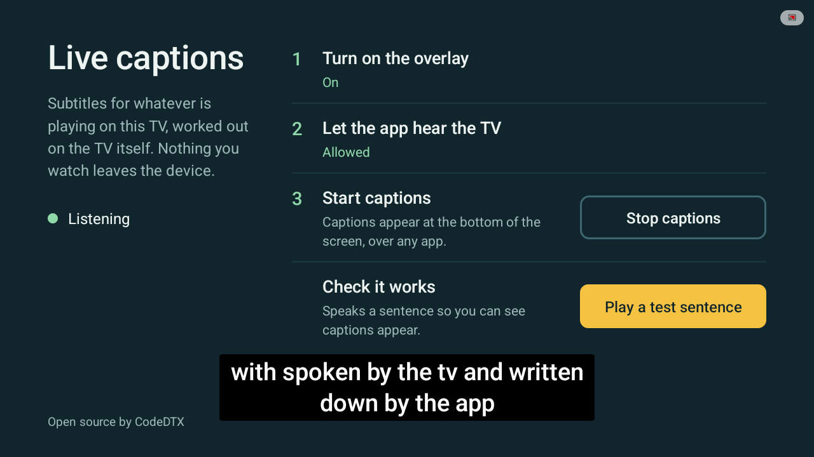
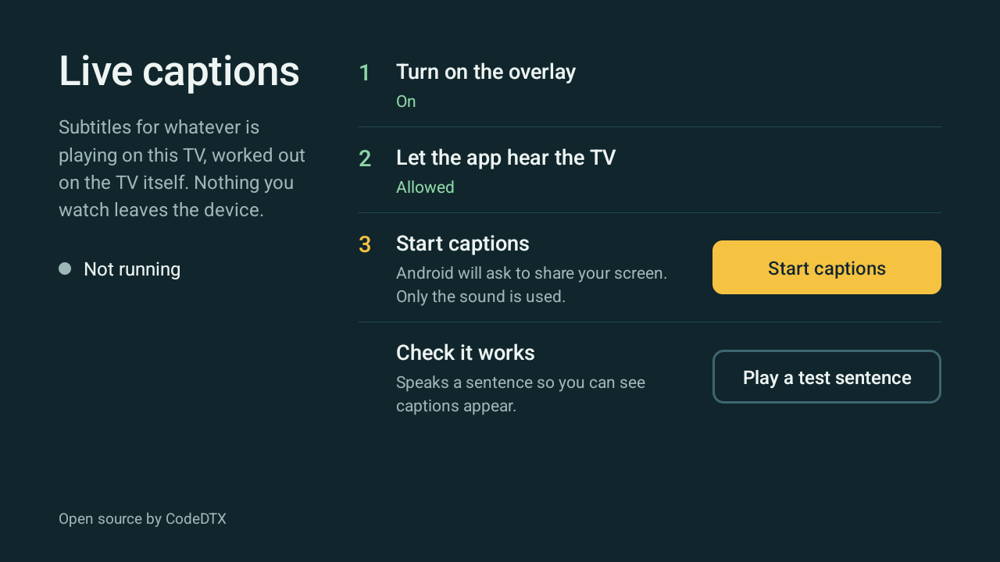

# Live captions for Android TV

Live subtitles for whatever is playing on an Android TV, drawn over any app.
Speech recognition runs on the TV itself. The app has no internet permission,
so nothing you watch can leave the device.



## What works, and what does not

The app can only caption audio that Android lets it hear. Android shares the
sound of apps that allow it and plays silence for apps that opt out.

- **Works:** apps that allow audio capture. Most local media players, many
  free and IPTV apps, and anything you play yourself.
- **Does not work:** apps that opt out. That includes most paid streaming apps,
  which already have their own subtitles.
- **The app tells you which case you are in.** If it hears only silence for
  eight seconds while running, the setup screen says so, rather than leaving
  you waiting for captions that cannot come.

Tested so far on the Android TV emulator (Android 16). Not yet tested on real
TV hardware. Reports from real devices are the most useful issue anyone can
open.

## Setup on the TV



Three steps with the remote, done once:

1. **Turn on the overlay.** Opens Accessibility settings. Choose Live captions
   under Services and turn it on. Android warns that accessibility services can
   read the screen. This one cannot: its configuration asks for no window
   content and no events, and it only owns the caption window.
2. **Let the app hear the TV.** Android calls this recording audio. The app
   only captures playback, never the microphone.
3. **Start captions.** Android asks to share your screen, because that grant
   is how it hands over playback audio. Only the sound is used.

Then press **Play a test sentence** to check that captions appear.

Captions follow your TV's own caption style (Settings, Accessibility,
Captions): size, colour, background and font.

### Setting it up over adb

For testing, or for TVs without an Accessibility settings screen:

```bash
adb install app/build/outputs/apk/debug/app-debug.apk
adb shell pm grant com.codedtx.livecaptions android.permission.RECORD_AUDIO
adb shell settings put secure enabled_accessibility_services com.codedtx.livecaptions/com.codedtx.livecaptions.overlay.CaptionOverlayService
adb shell settings put secure accessibility_enabled 1
```

The screen-share prompt in step 3 still has to be accepted on the TV.

## How it works

```
any app playing audio
        |
        v
AudioPlaybackCapture (MediaProjection grant)    audio/PlaybackCapture.kt
        |  16 kHz mono PCM
        v
Vosk, offline speech recognition                asr/VoskTranscriber.kt
        |  partial and final text
        v
CaptionTrack: wrap, roll up, expire             caption/CaptionTrack.kt
        |  2 lines of words
        v
accessibility overlay window                    overlay/CaptionOverlayService.kt
```

- `CaptionService` is a foreground service of type `mediaProjection`, the only
  kind Android lets hold a capture grant.
- Captions roll up the way live television does it: the bottom line fills, then
  the block scrolls up. Line breaks in confirmed text never move.
- Words the recogniser may still change are drawn at reduced opacity and turn
  solid once confirmed.
- The overlay uses an accessibility window rather than "display over other
  apps", because several Android TV builds have no screen to grant that.

## Building

Needs JDK 17 and the Android SDK.

```bash
./gradlew :app:testDebugUnitTest :app:assembleDebug
```

The first build downloads the English speech model (about 40 MB) from the Vosk
project into `app/src/main/assets/model-en-us`. It is not committed.

## Limits today

- English only, using the small Vosk model. It mishears more than a cloud
  service would, for example "was spoken" as "with spoken".
- No punctuation. The app capitalises the start of each sentence and "I", and
  nothing more.
- Android 10 or later, ARM devices only.
- The debug APK is about 95 MB, mostly the speech model.

The recogniser sits behind a small interface (`asr/Transcriber.kt`), so a
stronger on-device engine such as sherpa-onnx can replace Vosk without touching
capture or display.

## Licence

MIT, see [LICENSE](LICENSE).

Third-party parts:

- [Vosk](https://github.com/alphacep/vosk-api), Apache 2.0.
- [vosk-model-small-en-us-0.15](https://alphacephei.com/vosk/models), Apache 2.0.
- [JNA](https://github.com/java-native-access/jna), Apache 2.0.

Built by [CodeDTX](https://codedtx.com).
